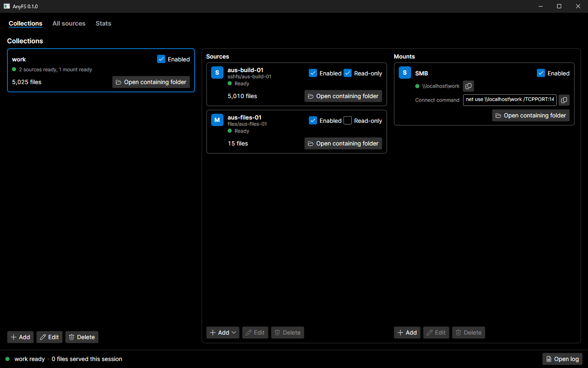
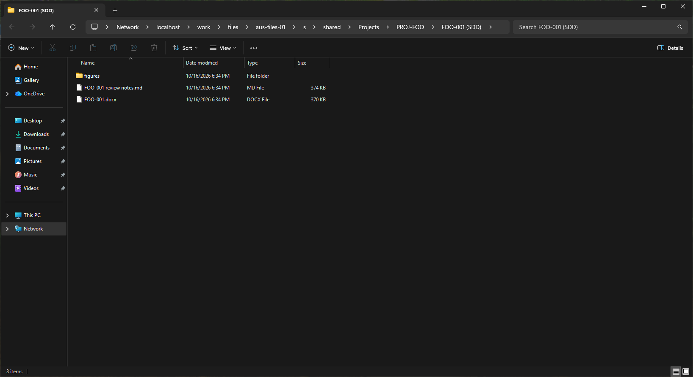

# AnyFS

AnyFS presents anything as a file system. This means you can turn any source of information (a document store, database, or issue tracker) into a set of files that can be read normally by programs and AI tools.

Anywhere there's information locked away, you can expose it in the only truly universal interface: a file.

It comes with a number of sources out of the box:

Corporate repositories:
* SharePoint: Online (Microsoft 365), Server (on-premises) and Embedded
* Confluence (Data Center)

Messaging apps:
* Outlook: PST and OST files, Exchange Online (Microsoft 365) and Exchange Server (on-premises)
* Teams
* Mattermost (TBC)

Software Development repos:
* GitLab: GitLab.com and Self-Managed
* Bitbucket (Data Center)
* Jira (Data Center)
* Bamboo (Data Center)
* Artifactory (TBC)

Systems Engineering repos:
* 3DEXPERIENCE (3DX)
* DOORS (TBC)
* Cameo (TBC)

Of these, SharePoint can be written to; the rest are read-only.

Sources sign in the way your organisation allows: through your own browser (no app registration needed), a Windows account, an app registration, an access token, or a user name and password, in the US Government cloud (GCC High) too.

Sources that are slow to ask (web APIs) keep their folder listings on disk between runs and walk their trees in the background, so browsing and searching answer from what AnyFS last saw, even over millions of files, and a restart carries on where it left off.

You can also write a plugin for your own information sources.

The files can be exposed in a number of ways:
* WinFSP
* FUSE
* SMB
* HTTP
* FTP
* WebDAV

[docs/mounts.md](docs/mounts.md) says how to connect to each one. The Operations tab shows what each source is being asked, as it happens; headless, `anyfs serve` runs the collections and `anyfs status` reports on them.

## Screenshots

Two sources in one collection, shared over SMB:

The collection in Windows Explorer:

## Download
Single-file executables for Windows, Linux, macOS can be found in the [releases page](https://github.com/fiddyschmitt/AnyFS/releases).

## Plugins

Drop a DLL into the `plugins` folder beside `settings`. A plugin references `AnyFS.Sdk` and
implements `ISourcePlugin` or `IMountProviderPlugin`; its settings are a POCO with `[Setting]`
attributes and the host builds the form, the JSON and the secret handling.
[tests/fixtures/SamplePlugin](tests/fixtures/SamplePlugin) is the 60-line example, and
`anyfs plugin check <dll>` tells you before a user does whether a DLL loads in the trimmed host
and uses only what it carries. [docs/plugin-authoring.md](docs/plugin-authoring.md) has the rest.
