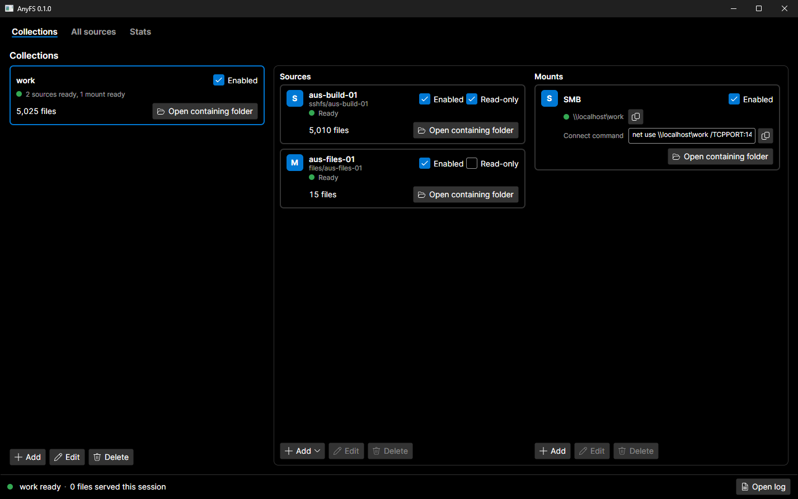
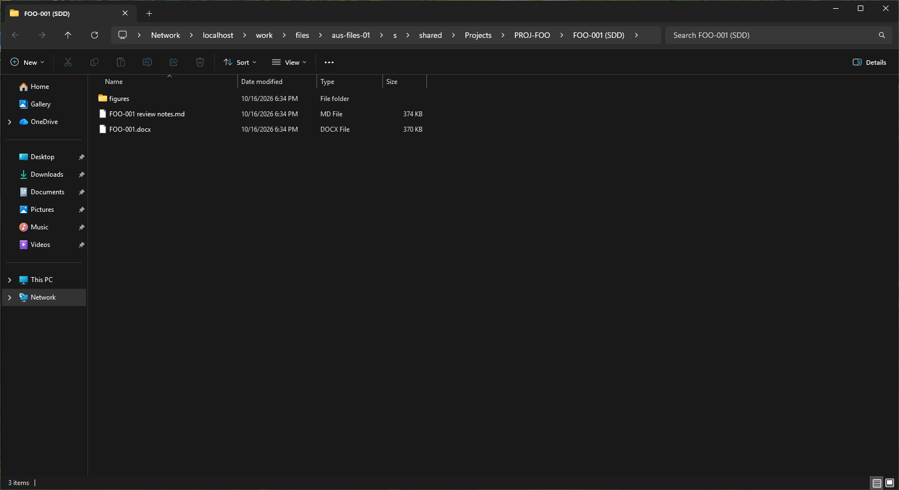

# AnyFS

AnyFS presents anything as a file system. This means you can turn any source of information (a document store, database, or issue tracker) into a set of files that can be read normally by programs and AI tools.

Anywhere there's information locked away, you can expose it in the only truly universal interface: a file.

It comes with a number of sources out of the box:

Corporate repositories:
* SharePoint: Online (Microsoft 365), Server (on-premises) and Embedded

Messaging apps:
* Outlook (PST & EWS) (TBC)
* Teams (TBC)
* Mattermost (TBC)

Software Development repos:
* Artifactory (TBC)
* BitBucket (TBC)
* GitLab (TBC)
  
Systems Engineering repos:
* DOORS (TBC)
* Cameo (TBC)
  
You can also write a plugin for your own information sources.

The files can be exposed in a number of ways:
* WinFSP
* FUSE
* SMB
* HTTP
* FTP
* WebDAV

## Screenshots

Two sources in one collection, shared over SMB:

The collection in Windows Explorer:

## Download
Single-file executables for Windows, Linux, macOS can be found in the releases page.

## Plugins

Drop a DLL into the `plugins` folder beside `settings`. A plugin references `AnyFS.Sdk` and
implements `ISourcePlugin` or `IMountProviderPlugin`; its settings are a POCO with `[Setting]`
attributes and the host builds the form, the JSON and the secret handling.
[tests/fixtures/SamplePlugin](tests/fixtures/SamplePlugin) is the 60-line example, and
`anyfs plugin check <dll>` tells you before a user does whether a DLL loads in the trimmed host
and uses only what it carries. [docs/plugin-authoring.md](docs/plugin-authoring.md) has the rest.
